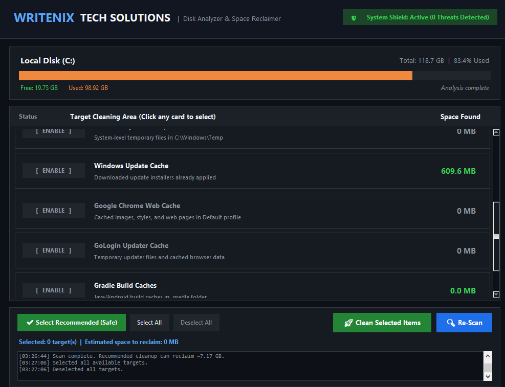

<div align="center">

# 🚀 Windows Simple Optimizer
### By Writenix Tech Solutions

**A lightweight, modern, open-source Windows storage analyzer and one-click disk reclaimer.**

[](https://github.com/Victorbots254/Windows-Simple-Optimizer-)
[](https://github.com/Victorbots254/Windows-Simple-Optimizer-)
[](#-quick-start-zero-installation)
[](LICENSE)
[](#-system-security--threat-shield)

<br/>



</div>

---

## 📌 Overview

Is your Windows **C: Drive** running out of space with only a few gigabytes remaining, while you can't see where all the storage went?

Most disk cleanup tools miss deep developer caches and hidden Windows system accumulation. **Windows Simple Optimizer** targets the exact locations where gigabytes of junk accumulate silently:
- PHP Composer cache archives
- Node.js / NPM caches
- Automated test browsers (Playwright Chromium / Firefox / WebKit)
- Google Chrome web caches
- System & User Temporary files (`%TEMP%` & `C:\Windows\Temp`)
- Windows Update downloaded installer residue
- GoLogin & updater caches
- Windows Hibernation kernel file (`hiberfil.sys`, reclaims ~4 GB instantly)

---

## ⚡ Quick Start (Zero Installation)

You don't need Python or any development environment to use this tool!

### 📥 Option 1: Direct Portable Download (Recommended)
1. Download the latest pre-built portable zip from the repository:
   👉 **[Download Writenix-Disk-Optimizer-v1.0.0.zip](release/Writenix-Disk-Optimizer-v1.0.0.zip)** (or from [Releases](https://github.com/Victorbots254/Windows-Simple-Optimizer-/releases))
2. Extract the `.zip` archive onto any drive (e.g. `Desktop` or `D:\`).
3. Double-click **`WritenixDiskOptimizer.exe`** (or right-click and choose **"Run as administrator"** to allow disabling the hibernation file).

---

## 📖 Step-by-Step User Guide

```
+-------------------------------------------------------------------------+
|  Step 1: Launch App   -->   Step 2: Select Targets  -->  Step 3: Clean  |
|  (Auto-scans C: Drive)      (Click cards or Presets)     (Reclaim GBs!) |
+-------------------------------------------------------------------------+
```

### Step 1: Launch & View System Shield
When you open the app, it immediately:
- Verifies your Windows Defender status and checks for active threats (visible in the top-right **System Shield** badge).
- Reads your **C: Drive** usage and renders a color-coded storage gauge.
- Scans all known developer and system cache targets in the background without freezing the UI.

### Step 2: Select What You Want to Clean
- **One-Click Safe Preset**: Click **`✔ Select Recommended (Safe)`** to automatically pick all zero-risk caches (Composer, NPM, Temp, Update cache).
- **Interactive Cards**: Click anywhere on any card to toggle it on or off. Selected items illuminate with a green `[ ✔ SELECTED ]` badge and blue outline.
- **Live Space Counter**: The bottom bar displays exact estimated gigabytes to be reclaimed in real-time.

### Step 3: Click "🚀 Clean Selected Items"
- A safety confirmation summary appears. Click **Yes**.
- The cleaner purges temporary junk, handles locked in-use files gracefully, and outputs each reclaimed file in the live log.
- Your drive usage bar updates instantly with your newly reclaimed free space!

---

## 🛡️ System Security & Threat Shield

Safety and transparency are our top priorities:
- **Windows Defender Integration**: Real-time protection status and threat counts are queried directly from Windows Defender.
- **Non-Destructive Cleaning**: This utility **never** touches your personal files, documents, photos, desktop items, or databases.
- **Locked File Protection**: Any file currently in active use by another application is safely skipped.
- **UAC Elevation for Kernel Files**: Removing `hiberfil.sys` safely triggers Windows User Account Control (UAC) so you remain in control of system permissions.

---

## 🛠️ Running From Source (For Developers)

If you'd like to inspect, modify, or run the Python script directly:

### Prerequisites
- Windows 10 or 11
- Python 3.10+

### Setup
```powershell
# 1. Clone the repository
git clone https://github.com/Victorbots254/Windows-Simple-Optimizer-.git
cd Windows-Simple-Optimizer-

# 2. Run the application
python writenix_optimizer.py
```

### Compiling Your Own Standalone Executable
To build a standalone `.exe` using PyInstaller:
```powershell
python -m pip install pyinstaller
python -m PyInstaller --onefile --noconsole --name "WritenixDiskOptimizer" writenix_optimizer.py
```
The compiled executable will be located in the `dist/` directory.

---

## 📂 Project Structure

```
Windows-Simple-Optimizer-/
├── docs/
│   └── screenshot.png          # App UI screenshot
├── release/
│   └── Writenix-Disk-Optimizer-v1.0.0.zip  # Pre-built portable distribution
├── HOW_TO_RUN.txt              # Quick instructions for standalone end users
├── LICENSE                     # MIT License
├── README.md                   # Full documentation and guide
├── run_writenix_optimizer.bat  # Fast launcher script
├── writenix_optimizer.py       # Core application source code
└── WritenixDiskOptimizer.exe   # Standalone executable
```

---

## 🤝 Contributing

Contributions, feature requests, and suggestions are welcome!
1. Fork the Project
2. Create your Feature Branch (`git checkout -b feature/NewFeature`)
3. Commit your Changes (`git commit -m 'Add awesome new feature'`)
4. Push to the Branch (`git push origin feature/NewFeature`)
5. Open a Pull Request

---

## 📜 License

Distributed under the **MIT License**. See [`LICENSE`](LICENSE) for more information.

Developed with ❤️ by **[Writenix Tech Solutions](https://github.com/Victorbots254)**.
